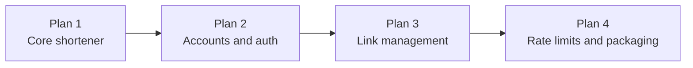

# URL Shortener API — Plan Tracker

Spec: [`../specs/2026-10-09-url-shortener-design.md`](../specs/2026-10-09-url-shortener-design.md)

Run the plans in order. Each plan ends with working, tested software. Tick a box when its plan is merged.

| Done | Plan | Delivers | Tasks | Tests after |
|------|------|----------|-------|-------------|
| [ ] | [Plan 1 — Core shortener](2026-10-09-plan-1-core-shortener.md) | Scaffold (Hibernate + Flyway, Lombok, Swagger UI), `links` schema, URL validation, anonymous `POST /api/links`, `GET /{slug}` redirect | 6 | 42 |
| [ ] | [Plan 2 — Accounts and auth](2026-10-09-plan-2-accounts-and-auth.md) | Security filter chain, Swagger **Authorize** (Bearer), register, login, refresh rotation, logout | 2 | 55 |
| [ ] | [Plan 3 — Link management](2026-10-09-plan-3-link-management.md) | Custom slugs, expiry, `410`, owner list/update/delete | 2 | 70 |
| [ ] | [Plan 4 — Rate limits and packaging](2026-10-09-plan-4-rate-limits-and-packaging.md) | Bucket4j limits with `429`, Dockerfile, Compose (`postgres:16-alpine`), README | 2 | 73 |

## Requirement coverage

| Requirement (spec section 2) | Plan |
|------------------------------|------|
| R1 Anyone can shorten a URL | 1 |
| R2 Short link redirects | 1 |
| R3 Register and log in | 2 |
| R4 Owners manage their links | 3 |
| R5 Anonymous links are unmanaged | 1 (no owner), 3 (`403` on manage) |
| R6 Custom slugs | 3 |
| R7 Expiry and disable return `410` | 3 |
| R8 Rate limits | 4 |
| R9 Docker and env-var config | 1 (env vars), 4 (Docker) |

## Prerequisites

- JDK 21
- Docker running (Testcontainers needs it for every integration test)
- Image `postgres:16-alpine` (already pulled on this machine)

## API contract for the UI repo

From Plan 1 on, the running API serves Swagger UI at `/swagger-ui.html` and the OpenAPI JSON at `/v3/api-docs`.
