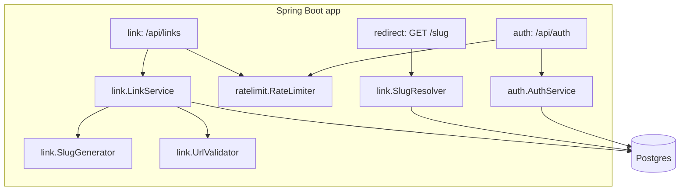

# URL Shortener API — Design Spec

Date: 2026-10-09
Status: Approved in brainstorming. Implementation is split into four plans (see `docs/superpowers/plans/README.md`).

## 1. Goal

A public URL shortener API for a real product at small scale (tens of thousands of links).
A separate UI app (`../url-shorterner-ui`) consumes this API.

## 2. Scope

### In scope (v1)

| # | Requirement |
|---|-------------|
| R1 | Anyone can shorten an `http`/`https` URL. Login is not required. |
| R2 | A visitor who opens a short link gets an HTTP redirect to the target URL. |
| R3 | Users can register and log in with email and password. |
| R4 | A logged-in user's links belong to that user. The user can list, edit, disable and delete them. |
| R5 | Anonymous links have no owner. Nobody can list, edit or delete them. |
| R6 | A creator can choose a custom slug (for example `/my-brand`). |
| R7 | A creator can set an expiry time. An owner can disable a link. Both make the link return `410 Gone`. |
| R8 | The API limits request rates to stop abuse. |
| R9 | The API runs in Docker and reads all configuration from environment variables. |

### Out of scope (v1)

Click analytics, QR codes, custom domains, password-protected links, safe-browsing checks,
teams, an admin dashboard, a job that deletes expired links, Redis, password reset, email verification,
an HTML error page for broken links (the UI owns presentation).

## 3. Tech stack

| Item | Choice |
|------|--------|
| Language | Java 21 |
| Framework | Spring Boot 4.1.1 (Spring MVC, Spring Data JPA, Spring Security 7) |
| ORM | Hibernate (through Spring Data JPA). Entities are the data model. |
| Schema | Flyway SQL migrations create and change tables. Hibernate runs `ddl-auto=validate` and refuses to start if an entity and its table disagree. |
| Database | PostgreSQL 16 (`postgres:16-alpine`) |
| Boilerplate | Lombok |
| API docs | springdoc-openapi 3.1.1: Swagger UI and OpenAPI 3 JSON |
| Auth tokens | JWT (HS256) through Spring Security OAuth2 Resource Server, plus an opaque refresh token |
| Rate limiting | Bucket4j 8.14.0 with an in-memory Caffeine map |
| Tests | JUnit 5, MockMvc, Testcontainers PostgreSQL (no H2) |
| Build | Maven wrapper |
| Packaging | Dockerfile + `compose.yaml` |

## 4. Architecture

One Spring Boot application. Postgres is the only datastore.
Code is grouped by feature. A feature uses another feature only through its public service classes.



| Package | Responsibility |
|---------|----------------|
| `com.urlshortener.link` | Create, list, update, delete links. Slug generation. URL validation. Slug lookup for redirects. |
| `com.urlshortener.redirect` | The public `GET /{slug}` endpoint. |
| `com.urlshortener.auth` | Users, password hashing, JWT access tokens, refresh tokens, security filter chain, CORS. |
| `com.urlshortener.ratelimit` | Per-IP and per-user request limits. |

`OpenApiConfig` (root package) holds the API title and the `bearerAuth` security scheme for springdoc.

`SlugResolver` is the only code path that redirects use to read links.
If redirect load grows, add a cache inside `SlugResolver`. Nothing else changes.

## 5. Data model

Each table has one Hibernate entity (`Link`, `User`, `RefreshToken`). A schema change needs both a new Flyway migration and the matching entity change.
`links.owner_id` is a plain `UUID` field on `Link`, not a `@ManyToOne`. This keeps the `link` package free of `auth` entity imports. The database still enforces the FK.

### `links`

| Column | Type | Notes |
|--------|------|-------|
| `id` | `UUID` PK | |
| `slug` | `VARCHAR(32)` NOT NULL | Constraint `uk_links_slug UNIQUE`. Case-sensitive. |
| `target_url` | `TEXT` NOT NULL | |
| `owner_id` | `UUID` NULL | FK to `users(id)` `ON DELETE CASCADE`. NULL means anonymous. |
| `is_custom` | `BOOLEAN` NOT NULL | |
| `active` | `BOOLEAN` NOT NULL DEFAULT TRUE | |
| `expires_at` | `TIMESTAMPTZ` NULL | |
| `created_ip` | `VARCHAR(45)` NULL | Fits IPv6 text. For abuse tracing. |
| `created_at` | `TIMESTAMPTZ` NOT NULL | |

Index `idx_links_owner_created ON links (owner_id, created_at DESC)` serves the owner's list.

### `users`

| Column | Type | Notes |
|--------|------|-------|
| `id` | `UUID` PK | |
| `email` | `VARCHAR(254)` NOT NULL | Constraint `uk_users_email UNIQUE`. Stored trimmed and lowercased. |
| `password_hash` | `VARCHAR(100)` NOT NULL | BCrypt. |
| `created_at` | `TIMESTAMPTZ` NOT NULL | |

### `refresh_tokens`

| Column | Type | Notes |
|--------|------|-------|
| `id` | `UUID` PK | |
| `user_id` | `UUID` NOT NULL | FK to `users(id)` `ON DELETE CASCADE`. |
| `token_hash` | `VARCHAR(64)` NOT NULL | SHA-256 hex of the token. The raw token is never stored. Constraint `uk_refresh_tokens_hash UNIQUE`. |
| `expires_at` | `TIMESTAMPTZ` NOT NULL | |
| `revoked_at` | `TIMESTAMPTZ` NULL | |
| `created_at` | `TIMESTAMPTZ` NOT NULL | |

Reserved slugs are a constant set in code, not a table:
`api, auth, login, logout, register, signup, health, admin, static, assets, error, favicon, robots, sitemap, docs, swagger-ui`.

## 6. API

All error responses from controllers use `application/problem+json` (RFC 9457, formerly 7807).
Exception: a `401` raised by the security filter for a bad or missing Bearer token has an empty body
and a `WWW-Authenticate` header (Spring Security default).

### Public

| Method | Path | Behavior |
|--------|------|----------|
| `GET` | `/{slug}` | `302` with `Location` and `Cache-Control: no-store`. `404` if unknown. `410` if disabled or expired. The path matches only `[A-Za-z0-9_-]{3,32}`. |
| `POST` | `/api/links` | Body `{targetUrl, customSlug?, expiresAt?}`. Bearer token optional. `201` with a link object. |
| `GET` | `/health` | Spring Boot Actuator health. |
| `GET` | `/swagger-ui.html` | Swagger UI. |
| `GET` | `/v3/api-docs` | OpenAPI 3 JSON. The UI repo reads this contract. |

### Auth

| Method | Path | Behavior |
|--------|------|----------|
| `POST` | `/api/auth/register` | Body `{email, password}`. `201 {id, email}`. `409` if the email exists. |
| `POST` | `/api/auth/login` | Body `{email, password}`. `200 {accessToken, tokenType: "Bearer", expiresIn}` and a `refresh_token` cookie. `401` on bad credentials. |
| `POST` | `/api/auth/refresh` | Reads the `refresh_token` cookie. Revokes it and returns a new access token and a new cookie. `401` if missing, revoked or expired. |
| `POST` | `/api/auth/logout` | Revokes the cookie's token if it is present. `204`. Clears the cookie. |

### Owner only (Bearer token required)

| Method | Path | Behavior |
|--------|------|----------|
| `GET` | `/api/links?page=0&size=20` | The caller's links, newest first. `{items, page, size, totalItems}`. `size` is clamped to 1..100. |
| `PATCH` | `/api/links/{id}` | Body `{targetUrl?, active?, expiresAt?}`. A null field stays unchanged. `403` if not the owner (this includes anonymous links). `404` if unknown. |
| `DELETE` | `/api/links/{id}` | `204`. Same `403`/`404` rules. |

### API documentation

- springdoc generates the OpenAPI document from controllers and records. Swagger UI is the shared contract with the UI repo.
- Every controller has `@Tag`. Every endpoint has `@Operation(summary)` and one `@ApiResponse` per status it can return, including the success status.
- Owner endpoints and `POST /api/links` carry `@SecurityRequirement(name = "bearerAuth")`. Swagger UI's **Authorize** button then sends the token.
- The docs are public in v1. Set `SPRINGDOC_API_DOCS_ENABLED=false` and `SPRINGDOC_SWAGGER_UI_ENABLED=false` to hide them.

### Link object

```json
{
  "id": "uuid",
  "slug": "a7Bx9Qz",
  "shortUrl": "https://sho.rt/a7Bx9Qz",
  "targetUrl": "https://example.com/page",
  "active": true,
  "expiresAt": null,
  "createdAt": "2026-10-09T10:00:00Z"
}
```

## 7. Rules

### Slugs

- A generated slug is 7 characters of base62 from `SecureRandom` (62^7, about 3.5 trillion values).
- The service inserts the row and lets the unique constraint detect a collision. It does not run a SELECT first.
  On a collision it retries with a new slug, up to 3 attempts in total.
- A custom slug matches `^[A-Za-z0-9_-]{3,32}$` and is not a reserved slug (case-insensitive check). Otherwise `400`.
  A taken custom slug gives `409`.
- Anonymous users can also choose custom slugs.
- A slug never changes after creation.

### Target URL validation (`UrlValidator`)

Reject with `400` when the URL:

1. is blank or longer than 2048 characters,
2. does not parse as a URI,
3. has a scheme other than `http` or `https` (this blocks `javascript:`, `data:`, `file:`),
4. has no host,
5. points to this shortener's own host (`APP_BASE_URL`), which would make a loop,
6. has host `localhost` or `*.localhost`,
7. has an IP literal host in a loopback, private, link-local, any-local or IPv6 unique-local range
   (`127/8`, `10/8`, `172.16/12`, `192.168/16`, `169.254/16`, `0.0.0.0`, `::1`, `fc00::/7`).

The server never fetches the target URL, so this is not an SSRF control. It stops the trusted short domain
from being used to send visitors to their own internal network. The check covers IP literals only.
It does not resolve DNS names.

### Expiry and disable

- `expiresAt` must be in the future when it is set (create or update). Otherwise `400`.
- The redirect checks `active` and `expiresAt` on each request. No job deletes expired rows.
- v1 cannot remove an expiry. The owner can set a later one.

### Redirect

Use `302` with `Cache-Control: no-store`. Do not use `301`.
Browsers cache a `301` without limit, so a link that is later disabled would keep redirecting from the cache.

### Authentication

- Passwords: BCrypt. Length 8..72 characters (BCrypt reads at most 72 bytes).
- Access token: JWT, HS256, signed with `JWT_SECRET` (at least 32 bytes; the app fails at startup otherwise).
  Lifetime 15 minutes. Claim `sub` is the user ID. Claim `email` is the email.
- Refresh token: 32 random bytes, base64url. Lifetime 30 days. Stored as a SHA-256 hash.
  Each refresh revokes the used token and issues a new one (rotation).
  A row lock stops two parallel refreshes from both succeeding with one token.
  Reuse of a revoked token gives `401`. v1 does not revoke the whole token family on reuse.
- Refresh cookie: `refresh_token`, `HttpOnly`, `Secure` (from `COOKIE_SECURE`, default true),
  `SameSite=Strict`, `Path=/api/auth`.
  Because of `SameSite=Strict`, the UI and the API must be on the same site (same registrable domain).
- CSRF protection is off. The API reads Bearer headers, and the only cookie is `SameSite=Strict`.
- CORS allows the origins in `CORS_ALLOWED_ORIGINS` on `/api/**`, with credentials.

### Rate limits

| Action | Limit | Key |
|--------|-------|-----|
| Create link, anonymous | 10 per hour | client IP |
| Create link, logged in | 100 per hour | user ID |
| Login | 5 per minute | client IP |
| Register | 3 per hour | client IP |
| Redirect | no limit | |

- An exceeded limit gives `429` with a `Retry-After` header (seconds).
- Buckets live in the JVM. With two or more instances, each limit multiplies by the instance count.
  Move buckets to Redis when you scale out.
- Limits are configurable through `app.rate-limit.*` properties.
- The client IP is `request.getRemoteAddr()`. Set `FORWARD_HEADERS_STRATEGY=native` only behind a trusted reverse proxy.
  If you set it without a proxy, clients can fake their IP and skip the limits.

## 8. Errors

| Status | When |
|--------|------|
| `400` | Validation failure, unsafe URL, bad custom slug, past expiry |
| `401` | Bad credentials, bad or missing refresh token, bad or missing Bearer token on owner routes |
| `403` | Caller does not own the link |
| `404` | Unknown slug or link ID |
| `409` | Email already registered, custom slug taken |
| `410` | Link disabled or expired |
| `429` | Rate limit exceeded |

## 9. Configuration

| Variable | Default | Purpose |
|----------|---------|---------|
| `DATABASE_URL` | `jdbc:postgresql://localhost:5432/urlshortener` | JDBC URL |
| `DATABASE_USERNAME` | `urlshortener` | |
| `DATABASE_PASSWORD` | `urlshortener` | |
| `JWT_SECRET` | none (required) | HS256 key, at least 32 bytes |
| `APP_BASE_URL` | `http://localhost:8080` | Prefix for `shortUrl`. No trailing slash. |
| `CORS_ALLOWED_ORIGINS` | `http://localhost:5173` | Comma-separated UI origins |
| `COOKIE_SECURE` | `true` | Set `false` only for plain-HTTP testing outside localhost |
| `FORWARD_HEADERS_STRATEGY` | `none` | `native` behind a trusted proxy |

## 10. Code conventions

- Lombok on entities: `@Getter`, `@NoArgsConstructor(access = AccessLevel.PROTECTED)`, `@Setter` only on fields that may change.
  No `@Data` or `@EqualsAndHashCode` on entities: generated `equals`/`hashCode` over mutable fields breaks Hibernate collections and lazy loading.
- Lombok on Spring beans: `@RequiredArgsConstructor` with `private final` fields. `@Value` goes on the field; `lombok.config` copies it to the constructor.
- DTOs are Java records. Lombok adds nothing there.

## 11. Testing

- Unit tests: `SlugGenerator`, `UrlValidator` (one case per reject rule).
- Integration tests: `@SpringBootTest` + MockMvc + Testcontainers `postgres:16-alpine`.
  H2 is not allowed: it differs from Postgres on constraints and types.
- Docker must run on the machine that runs the tests.
- Key flows under test: create then redirect; slug collision retry; custom slug `409`; reserved slug `400`;
  disable or expire then `410`; ownership `403`; refresh rotation and reuse `401`; rate limit `429`;
  OpenAPI document has the title, the `bearerAuth` scheme, success schemas and the documented error codes.

## 12. Future upgrades (not v1)

| Trigger | Upgrade |
|---------|---------|
| Redirect latency or DB load grows | Cache inside `SlugResolver` (Redis) |
| More than one app instance | Redis-backed Bucket4j |
| `links` table size hurts | Scheduled delete of long-expired links |
| Stolen refresh tokens become a concern | Revoke the whole token family on reuse |
| Product needs it | Click analytics as a separate write path |
